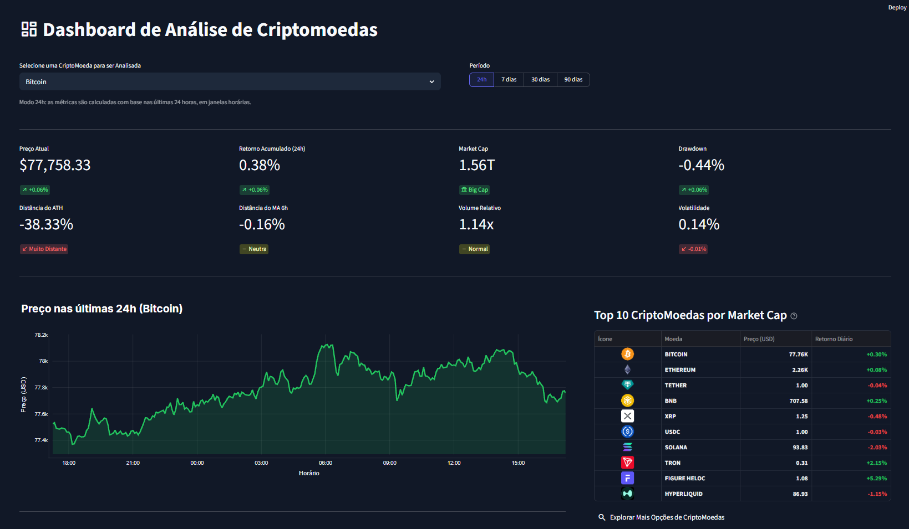
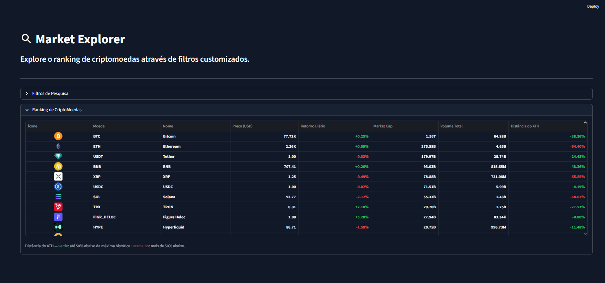
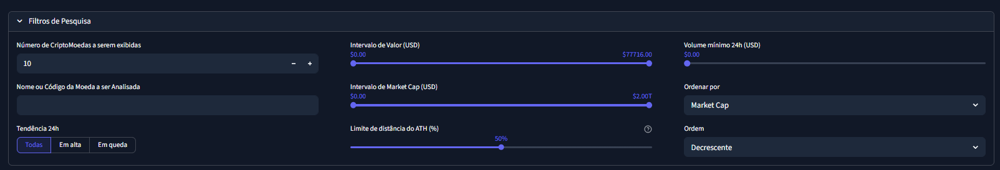
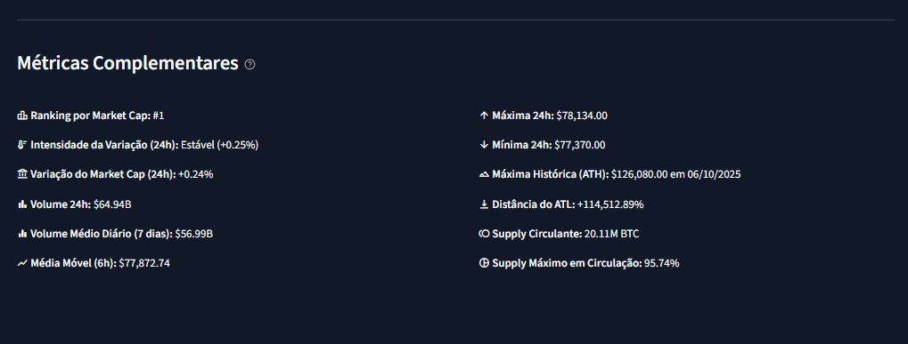

<div align="center">

# Crypto Dashboard

**Dashboard interativo para analisar criptomoedas: dados de mercado quase em tempo real, métricas técnicas calculadas com pandas e um explorador de mercado com filtros.**


[Instalação](#como-instalar-e-rodar) · [Métricas](#métricas-calculadas) · [Limites da API](#api-limites-de-requisições-e-cache)

</div>

---

## Sumário

- [Sobre o projeto](#sobre-o-projeto)
- [Demonstração](#demonstração)
- [Funcionalidades](#funcionalidades)
- [Tecnologias utilizadas](#tecnologias-utilizadas)
- [Pré-requisitos](#pré-requisitos)
- [Como instalar e rodar](#como-instalar-e-rodar)
- [Como usar](#como-usar)
- [Métricas calculadas](#métricas-calculadas)
- [Como interpretar os valores](#como-interpretar-os-valores)
- [API, limites de requisições e cache](#api-limites-de-requisições-e-cache)
- [Decisões técnicas](#decisões-técnicas)
- [Próximos passos](#próximos-passos)
- [Autor](#autor)

---

## Sobre o projeto

### O problema

Analisar uma criptomoeda costuma exigir várias abas abertas: uma para o gráfico de preço, outra para o volume, outra para o market cap, outra para saber a distância até a máxima histórica, a chamada ATH. Além disso, boa parte dos indicadores úteis (drawdown, volatilidade, volume relativo, distância das médias móveis) **não são entregues prontos pelas APIs públicas**, eles precisam ser calculados a partir de dados brutos.

### A solução

O **Crypto Dashboard** reúne essas informações em um só lugar. Ele consome a API pública da [CoinGecko](https://www.coingecko.com/), processa os dados com **pandas** e **NumPy** e apresenta o resultado em uma interface **Streamlit** com gráficos interativos em **Plotly**.

O projeto tem duas páginas:

- **Dashboard**: análise detalhada de uma moeda escolhida (8 métricas com leitura rápida, gráfico de preço com médias móveis e volume, e métricas complementares).
- **Market Explorer**: ranking das maiores criptomoedas com filtros e ordenação customizáveis.

### Objetivo

Este é um projeto de portfólio com foco em **engenharia de dados e backend aplicados na prática**: consumo de API com cache e tratamento de falhas, transformação de séries temporais com pandas, separação de responsabilidades em camadas e uma interface que traduz números em leituras acessíveis.

> **Aviso:** Este é um projeto com foco no aprendizado e aplicação de conceitos sobre programação backend e análise de dados. Não leve os dados como recomendação profissional de investimento!

---

## Demonstração

<!-- Adicione os arquivos em docs/screenshots/ e ajuste os nomes, se necessário -->


<table>
  <tr>
    <td align="center"><b>Dashboard</b></td>
    <td align="center"><b>Market Explorer</b></td>
  </tr>
  <tr>
    <td></td>
    <td></td>
  </tr>
  <tr>
    <td align="center"><b>Opções de filtros disponíveis</b></td>
    <td align="center"><b>Métricas complementares</b></td>
  </tr>
  <tr>
    <td></td>
    <td></td>
  </tr>
</table>

---

## Funcionalidades

### Página Dashboard

- **Seleção de moeda**: qualquer criptomoeda listada na API do CoinGecko (padrão: Bitcoin).
- **Períodos**: 24h, 7, 30 e 90 dias.
- **8 cards de métricas** com badges fetas para garantir uma leitura rápida (cor e ícone): preço atual, retorno acumulado, market cap (com faixa Small/Mid/Big Cap), drawdown, distância do ATH, distância da média móvel, volume relativo e volatilidade.
- **Gráfico interativo de preço** com preenchimento verde/vermelho conforme a direção em relação ao início do período analisado, médias móveis (7/30/90 dias, exibidas apenas quando a janela é menor que o período) e painel de volume.
- **Modo 24h**: série de 5 em 5 minutos no gráfico, com as métricas recalculadas em janelas horárias.
- **Top 10 Moedas por Market Cap** com ícones, retorno diário colorido e valores formatados.
- **12 métricas complementares**: ranking, intensidade da variação, variação do market cap, volume 24h, volume médio, média móvel, máxima e mínima de 24h, ATH (preço e data), distância do ATL, supply circulando e percentual do supply máximo.

### Página Market Explorer

- Ranking das **maiores criptomoedas** por market cap.
- **Filtros**: nome ou código da moeda, quantidade de moedas exibidas, intervalo de preço e intervalo de market cap.
- **Ordenação** por 5 critérios (market cap, preço, retorno diário, volume total e distância do ATH), crescente ou decrescente.
- **Coloração da distância do ATH com limite configurável**: verde para moedas mais próximas da máxima histórica, vermelho para as mais distantes (o padrão é 50% de distância, podendo ser configurado).

---

## Tecnologias utilizadas

| Tecnologia | Versão | Uso no projeto |
|---|---|---|
| [Python](https://www.python.org/) | 3.11+ | Linguagem principal |
| [Streamlit](https://streamlit.io/) | 1.56.0 | Interface, navegação multipágina, widgets e cache |
| [pandas](https://pandas.pydata.org/) | 3.0.2 | Tratamento e cálculo de métricas sobre séries temporais |
| [NumPy](https://numpy.org/) | 2.4.4 | Classificações vetorizadas e tratamento de valores inválidos |
| [Plotly](https://plotly.com/python/) | 6.7.0 | Gráficos interativos (subplots de preço e volume) |
| [Requests](https://requests.readthedocs.io/) | 2.33.1 | Consumo da API REST |
| [CoinGecko API v3](https://docs.coingecko.com/) | v3 | Fonte dos dados de mercado |

> As versões acima estão detalhadas no `requirements.txt`. O Python 3.11 ou superior é exigido pelas versões fixadas de pandas e NumPy.

---

## Pré-requisitos

- **Python 3.11 ou superior** (`python --version`)
- **pip** (já incluso na instalação padrão do Python)
- **Git**, para clonar o repositório
- **Conexão com a internet**: os dados vêm da API da CoinGecko
- Nenhuma chave de API é necessária

---

## Como instalar e rodar

```bash
# 1. Clone o repositório
git clone https://github.com/giovanni-pirolla/dashboard_crypto.git
cd dashboard_crypto

# 2. Crie e ative um ambiente virtual
python -m venv .venv

# Windows (PowerShell)
.venv\Scripts\Activate.ps1
# Linux / macOS
source .venv/bin/activate

# 3. Instale as dependências
pip install -r requirements.txt

# 4. Execute o app
streamlit run app.py
```

O dashboard abre em `http://localhost:8501`.

---

## Como usar

### Dashboard: analisando uma moeda

1. Abra a página **Dashboard** pela barra lateral.
2. Escolha uma criptomoeda no seletor (ex.: *Ethereum*) e um período (ex.: *30 dias*).
3. Leia os cards do topo: o valor principal mostra a métrica e o **badge** mostra a leitura (cor e ícone) ou a variação em relação ao ponto anterior.
4. Passe o mouse sobre o gráfico para ver preço, médias móveis e volume em cada data.
5. Role até **Métricas Complementares** para ver máximas e mínimas, ATH, supply e volume médio.
6. Selecione **24h** para ver o movimento do dia em intervalos de 5 minutos. As métricas passam a ser calculadas em janelas horárias.

### Market Explorer: filtrando o ranking

Exemplo: *moedas de médio porte, com preço baixo, ordenadas pelas que mais negociam*.

1. Abra **Market Explorer**.
2. Em **Intervalo de Market Cap**, selecione de `$1.00B` a `$100.00B`.
3. Em **Ordenar por**, escolha *Volume Total* e, em **Ordem**, *Decrescente*.
4. Ajuste o **Limite de distância do ATH** (ex.: 60%): moedas a menos de 60% da máxima histórica ficam em verde, as demais em vermelho.
5. Digite parte do nome ou do símbolo (ex.: `sol`) para refinar a busca.


## Métricas calculadas

A API entrega preços, volumes e market caps brutos. As métricas abaixo são **calculadas** no projeto:

<details>
<summary><b>Série histórica</b> (<code>processing/history_processing.py</code>)</summary>

| Métrica | Cálculo |
|---|---|
| Retorno diário | `pct_change() × 100` entre pontos consecutivos |
| Retorno acumulado | `(preço − preço inicial) / preço inicial × 100` |
| Drawdown | `(preço − máxima acumulada) / máxima acumulada × 100`, com `cummax()` |
| Média móvel (MA) | `rolling(janela).mean()` para 7, 30 e 90 pontos |
| Distância da MA | `(preço − MA) / MA × 100` |
| Volatilidade | desvio-padrão dos retornos diários na janela (`rolling(janela).std()`) |
| Volume relativo | `volume / média do volume na janela` |

Cada métrica também tem uma coluna de **delta** (`diff()`), usada nos badges para mostrar a variação em relação ao ponto anterior.

</details>

<details>
<summary><b>Dados de mercado</b> (<code>processing/market_processing.py</code>)</summary>

| Métrica | Cálculo |
|---|---|
| Distância do ATH | `(preço − ATH) / ATH × 100` |
| Distância do ATL | `(preço − ATL) / ATL × 100` |
| Percentual do supply | `supply circulante / supply máximo × 100` |
| Faixa de mercado | Small Cap: market cap < US$ 2 bi · Mid Cap: US$ 2 bi a 10 bi · Big Cap: ≥ US$ 10 bi |
| Intensidade da variação 24h | ≤ −10%: queda acentuada · −10% a −3%: queda moderada · −3% a +3%: estável · +3% a +10%: alta moderada · ≥ +10%: alta forte |

</details>

<details>
<summary><b>Modo 24h</b></summary>

Os dados de 5 em 5 minutos são usados no gráfico. Para as métricas, a série é **reamostrada para 1 hora** e passa pelo mesmo processamento, com janela de 6 horas no lugar das janelas em dias. O volume relativo compara o volume das últimas 24h com a **média diária dos últimos 7 dias**.

</details>

---

## Como interpretar os valores

Os indicadores resumem o comportamento recente do preço e **não preveem o futuro**. Pontos de atenção:

| Métrica | Como ler | Cuidado |
|---|---|---|
| **Retorno acumulado** | Variação desde o início do período escolhido | Depende do período: 7 e 90 dias podem apontar sentidos opostos |
| **Retorno diário** | Variação entre os dois últimos pontos da série | Pode diferir da variação em 24h móvel usada nas tabelas (Top 10 e Market Explorer) |
| **Drawdown** | Queda em relação à máxima **do período selecionado** | Não é a distância do ATH |
| **Distância da MA** | Positiva: preço acima da média. Negativa: abaixo | Em tendências fortes, o preço pode ficar longe da média por muito tempo |
| **Volume relativo** | 1,0x = volume na média; acima disso, atividade maior que o normal | Não indica direção, só intensidade |
| **Volatilidade** | Desvio-padrão dos retornos, em pontos percentuais, sem anualizar | No modo 24h usa retornos horários, então **não é comparável** com os demais períodos |
| **Market cap e faixas** | Preço × supply circulante; faixas Small/Mid/Big são heurísticas | Não representa dinheiro realmente investido, e os cortes são arbitrários |
| **Supply máximo (%)** | Quanto da oferta máxima já circula | Aparece como `N/D` em moedas sem teto de emissão, como Ethereum e Dogecoin |
| **Distância do ATL** | Quanto o preço subiu desde a mínima histórica | Valores enormes (milhares de %) são comuns porque a base é minúscula |

### Distância do ATH

É a métrica que mais pede cautela, porque o mesmo número tem leituras opostas conforme a estratégia:

- **Perto do ATH** pode indicar força (não há preço histórico acima funcionando como resistência), mas também uma região de realização de lucros.
- **Longe do ATH não significa "barato"**. Para muitos ativos, o topo foi uma anomalia de euforia e não um preço de referência.
- A conta de recuperação é assimétrica: uma queda de **50%** exige uma alta de **+100%** para voltar ao ATH, e uma queda de **90%** exige **+900%**.
- Como referência histórica, nos ciclos anteriores o Bitcoin chegou a cair entre cerca de 75% e 93% a partir do topo. Altcoins, em geral, sofrem quedas ainda mais profundas.

Por isso a coloração verde/vermelha do Market Explorer é uma **ferramenta de triagem visual**, e não um sinal de compra ou venda.

### Qualidade dos dados

- Os dados da CoinGecko são agregados de várias exchanges e podem ter **atraso de cerca de 1 a 2 minutos**.
- No modo 24h, o volume da API é o **acumulado das últimas 24h** em cada instante, e não o volume de cada intervalo de 5 minutos. Por isso a métrica é nomeada como "Volume 24h".
- Datas do histórico diário estão em **UTC**. O modo 24h usa o horário de Brasília (`America/Sao_Paulo`).
- Moedas pequenas podem ter ATH, volume e preço distorcidos por pouca liquidez.

---

## API, limites de requisições e cache

O projeto usa a **API pública e gratuita da CoinGecko (v3)**, sem chave de API. Esse acesso tem **limite de requisições por minuto**. Ao excedê-lo, a API responde com **HTTP 429**, e os dados deixam de carregar por um tempo. Portanto, evite realizar muitas buscas por moedas ou alterar o período analisado com muita frequência. Em caso de erro ao carregar os dados da moeda, aguarde cerca de um minuto e execute a busca novamente.

### Endpoints utilizados

| Endpoint | Para que serve | Cache (TTL) |
|---|---|---|
| `/coins/list` | Lista de moedas do seletor | 24 horas |
| `/coins/{id}/market_chart` (diário) | Histórico de 7, 30 e 90 dias | 5 minutos |
| `/coins/{id}/market_chart` (`days=1`) | Série intraday de 5 em 5 minutos | 60 segundos |
| `/coins/markets?ids={id}` | Dados de mercado da moeda selecionada | 60 segundos |
| `/coins/markets` (top 100) | Ranking, Top 10 e Market Explorer | 60 segundos |

O TTL de cada função (`st.cache_data`) acompanha a velocidade com que o dado muda: a lista de moedas quase não varia, o histórico diário muda devagar e os dados de mercado mudam a todo momento.

### Tratamento de falhas

A camada de serviço captura erros HTTP e de conexão (retornando um `DataFrame` vazio e registrando o erro). O carregamento do histórico e a página Market Explorer exibem uma mensagem amigável quando os dados não chegam, em vez de quebrar a página.

---

## Decisões técnicas

- **Separação em camadas** (`services` → `processing` → `plots` → `pages`): a lógica de cálculo não conhece a interface e pode ser testada ou reaproveitada isoladamente.
- **Cache com TTL por tipo de dado**: reduz chamadas à API e mantém a interface rápida, respeitando a frequência de atualização de cada endpoint.
- **pandas vetorizado**: `pct_change`, `rolling`, `cummax`, `diff` e `np.select`, sem laços sobre linhas.
- **Filtrar antes de formatar**: no Market Explorer, filtros e ordenação rodam sobre colunas numéricas, e só depois a tabela é formatada e estilizada. Assim, a formatação (sufixos K/M/B/T, cores) não interfere na ordenação.
- **Reamostragem no modo 24h**: a série de 5 minutos é agregada para 1 hora, e o mesmo pipeline de métricas é reaproveitado com janelas parametrizáveis (`processar_historico(df, janelas=...)`).
- **Tratamento de valores ausentes**: `NaN` e `None` viram `N/D` na interface em vez de quebrar a formatação (por exemplo, moedas sem supply máximo).
- **Fuso horário explícito**: timestamps da API (UTC) convertidos para o fuso local no modo intraday.
- **Navegação nativa do Streamlit**: `st.navigation` com menu customizado na sidebar via `st.page_link`.

---

## Próximos passos

Ideias para o futuro do projeto:

- [ ] Comparação entre duas ou mais moedas
- [ ] Deploy no Streamlit Community Cloud
- [ ] Implementação de um modelo de predição dos preços das moedas com base nas séries históricas 

---

## Autor

**Giovanni Pirolla**

- GitHub: [@giovanni-pirolla](https://github.com/giovanni-pirolla)
- LinkedIn: [seu-perfil](www.linkedin.com/in/giovannippirolla)
- E-mail: giovannippirolla@gmail.com

---

<div align="center">

Se este projeto foi útil ou interessante, considere deixar uma estrela no repositório.

---
</div>
